# RHYTHMER

[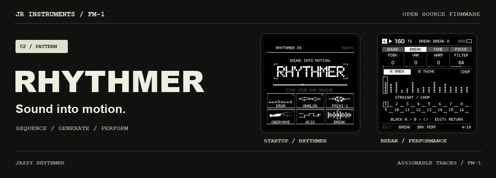](https://jazzyrhythmer.github.io/Rhythmer/)

**Sound into motion.** Build a groove one track at a time. Swap a drum voice, generate a fresh part, or slice a break and play the changes into the sequence. Rhythmer is an open-source groovebox for the M‑VAVE FM‑1, with up to six assignable tracks.

[**Play in your browser**](https://jazzyrhythmer.github.io/Rhythmer/#play) · [**Install Rhythmer**](https://jazzyrhythmer.github.io/Rhythmer/installer/) · [**Web editor**](https://jazzyrhythmer.github.io/Rhythmer/editor/) · [Manual](https://jazzyrhythmer.github.io/Rhythmer/#guide) · [PDF](https://jazzyrhythmer.github.io/Rhythmer/downloads/Rhythmer-Manual-v0.1.2-dev1.pdf) · [Releases](https://github.com/JazzyRhythmer/Rhythmer/releases)

Built by [Jazzy Rhythmer](https://jazzyrhythmer.github.io/) on [JIANT](https://github.com/juanjiant-bit/JIANT)'s sequencing and project system. [JAZZY](https://github.com/JazzyRhythmer/Jazzy) is the companion firmware for exploring a wider palette of individual sounds. [Watch them side by side](https://jazzyrhythmer.github.io/Rhythmer/#companion).

## Multi-Break · build 20261111.3

Use Break on several tracks at once, with shared A/B audio and independent playback, chops and modulation. GEN targets T1–T6 directly and shows Break controls for the selected Break track. Both factory Break banks remain included. [Update and compatibility notes](docs/releases/20261111.3.md) · [Sample preparation](https://jazzyrhythmer.github.io/Rhythmer/editor/?target=browser#samples)

## Explore the machines

| Acid / NEW + MUTATE | Break / chops + repeats |
| --- | --- |
| 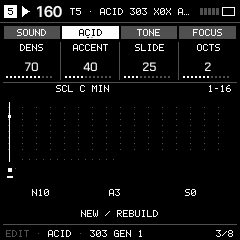 | 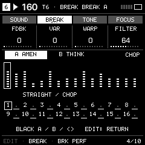 |
| ACID track → EDIT → ACID tab → 303 GEN 1 / 2. OCT+ generates a new line; OCT− mutates it. SCL supplies the root and scale. [Acid guide](docs/ACID.md) | BREAK track → EDIT → BREAK tab. Play slices and repeat/up/down commands; SEQ edits the actual events. Hold SEQ for STRAIGHT / MUTATE / RANDOM. [Break guide](docs/BREAK.md) |

## The machines in motion

Host-rendered firmware UI driven by note, envelope and preset input; silent previews, not physical-device footage. FM6 cycles patches to show its operator networks. [Try the actual firmware with sound](https://jazzyrhythmer.github.io/Rhythmer/#play).

| | | |
| --- | --- | --- |
| **DRUM** 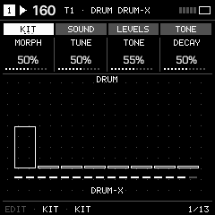 Synthesized percussion | **WAVETABLE** 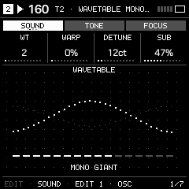 Wavetable morphing | **FMINI-1** 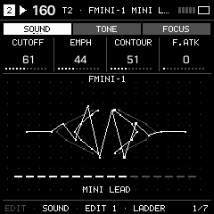 Ladder-filter basses and leads |
| **OBERVAVE** 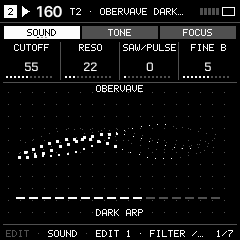 Vintage polysynth textures | **ANALOG** 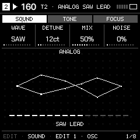 Classic waveforms | **FM6** 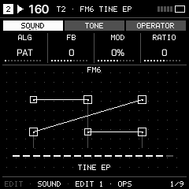 Six-operator patch networks |
| **FM+STAT** 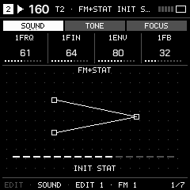 Compact FM | **SWAV-SAW** 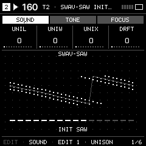 Layered saws | **SID-6581** 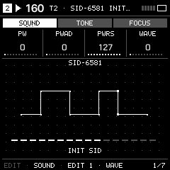 Chip-style synthesis |

## Build the pattern

| HOME GEN / Target MIDI | DRUM / Sound select | GEN / Break chops |
| --- | --- | --- |
| 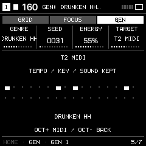 | 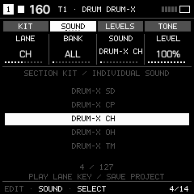 | 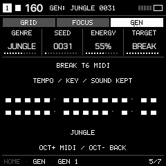 |
| Generate one track's notes in the selected genre. | Swap one sound without replacing the rest of the kit. | Generate chops for the Break track, wherever it is assigned. |

## Machines and sequencing

- Up to six assignable tracks; fresh settings start with four active tracks: DRUM / WAVETABLE / FMINI-1 / OBERVAVE. T5/T6 start EMPTY. Confirm six-track mode with OCT+ to fill empty T5/T6 with ACID / BREAK; existing sounds and notes are kept and a Break on another track is never duplicated.
- Synths: Wavetable, FMINI-1 (43 presets), OberVave (32 presets), Analog, FM6, FM+STAT, SWAV-SAW and SID-6581. FMINI-1 and OberVave keep their original filter designs.
- Drums include the complete 55-preset Hortator MD bank (57 articulations / 21 kernels), 31 kits including 12 Drum-X LXR-X interpretations and two experimental MD LAB kits, and individual lane sound replacement. Drum attacks are protected for about 40 ms; tails then use the ordinary shared voice/CPU policy, without a separate MD-only cap.
- Multiple Acid tracks; one Break machine per project, assignable anywhere. Machine-specific EDIT/SEQ pages follow the selected machine.
- Acid NEW/MUTATE follows SCL (default CHR). Factory cutoff is 80 for three presets and 50 for HT SCREAMER. Saved projects keep their values.
- Break: 16 chops, 16 performance/repeat commands, source A/B and return commands in the real sequence. Hold SEQ for STRAIGHT / MUTATE / RANDOM, tail fills, beat shuffle, reverse order, shifts and A/B sequencing. Saved periodic mutation supports ORBIT/DRIFT.
- Break follows the normal track filter, ADSR and both LFOs. Fresh Break tracks select A / Amen with an empty two-bar sequence. Hold SEQ + F3 for a straight loop; saved edits remain intact.
- Five per-track SEQ generators (Euclid, Mutate, Turing, Cellular and Grids), plus 59 arrangement genres and targeted MIDI/Break GEN.
- **Sidechain and Kick Link.** Trigger ducking from a kick, a track or kit lane, USB audio or a MIDI note. Send a kick to JAZZY or receive one back over USB MIDI. [Sidechain and Kick Link guide](https://jazzyrhythmer.github.io/Rhythmer/#guide/sidechain).
- Four projects with A–D sections and explicit section/project clearing. Two LFOs per track, shared FX and ducking with local, USB-audio and timing-only MIDI triggers. Four-/six-track modes preserve inactive tracks.
- USB MIDI Host for class-compliant USB MIDI controllers. Use Device mode for the installer and USB editor.
- Web editor for actual sounds/patterns, musical archive import/export and user-replaceable two-bar A/B loops. Conversion to 16 kHz mono packed PCM12 happens in the browser. Musical archives do not contain audio: retain your original samples separately.

## Release and compatibility

The current public beta is **v0.1.2-dev1 · build 20261109.18 · FM-1_748023**. The installer and browser emulator run the same package. New browser sessions start in four-track mode with empty sequences and both factory Break banks ready. Existing emulator saves remain associated with their firmware hashes.

**Back up before updating.** PHASE, LOFI and WHEEL were retired to make room for the two new synths. Projects containing those engines open with Analog on the affected tracks; retain a backup and use the [previous release](https://github.com/JazzyRhythmer/Rhythmer/releases/tag/v0.1.1-beta3) if you need those sounds. Use official V15 when switching between firmware families. Installing restores the bundled Amen and Think banks; save your custom audio separately.

See [exact build validation](RELEASE-VALIDATION.json) for emulator, editor and installer test scope. Dense arrangements can still exceed the device's audio budget. Mute tracks, reduce simultaneous notes or simplify FX if needed.

## Samples, credits and license

Source is GPL-3.0-only; original component licenses and notices remain. The active firmware is in `rhythmer/`. See `docs/THIRD_PARTY.md`, `rhythmer/LICENSING.md` and the component license directories.

Amen: The Winstons, *Amen, Brother*, Gregory C. Coleman on drums; source via Amenity. Think: Lyn Collins, *Think (About It)*; a two-bar drum edit from owner-supplied files. Each prepared loop is two bars at 160 BPM, mono 16 kHz / PCM12. **These recordings are separate from the code license.** The owner directs their inclusion with credits; recording/composition redistribution permission has not been documented. Credits, installation acknowledgements, free access and this repository do not grant a blanket sample license. Replace either loop through the web editor or obtain permission appropriate to your use. See `audio-rights.json` and `THIRD-PARTY-AUDIO.txt`.

Built from community work including Felucca, JIANT, X0X, Amenity, Garden-FM, MONO2K, Hortator, Elixir and OberVave. Neither those authors nor M-VAVE or Elektron are claimed to endorse Rhythmer. Machinedrum and other referenced product names belong to their owners.

Independent community firmware, supplied without warranty to the extent permitted by law. Firmware changes can affect data or device operation. Mandatory legal rights and non-excludable liability remain unaffected. Read `LEGAL-NOTICE.txt`.

## Watch Rhythmer

[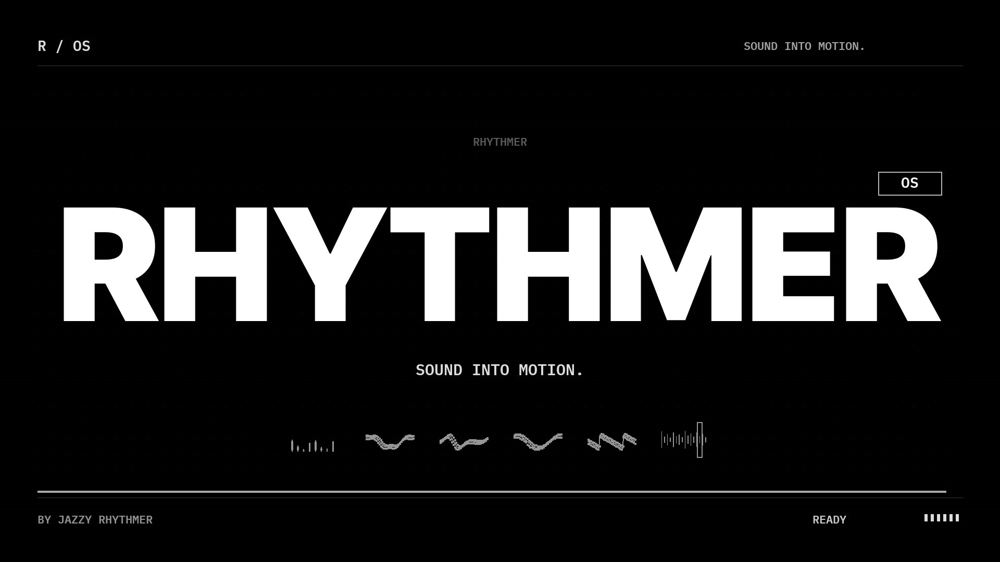](https://jazzyrhythmer.github.io/Rhythmer/#opening)
