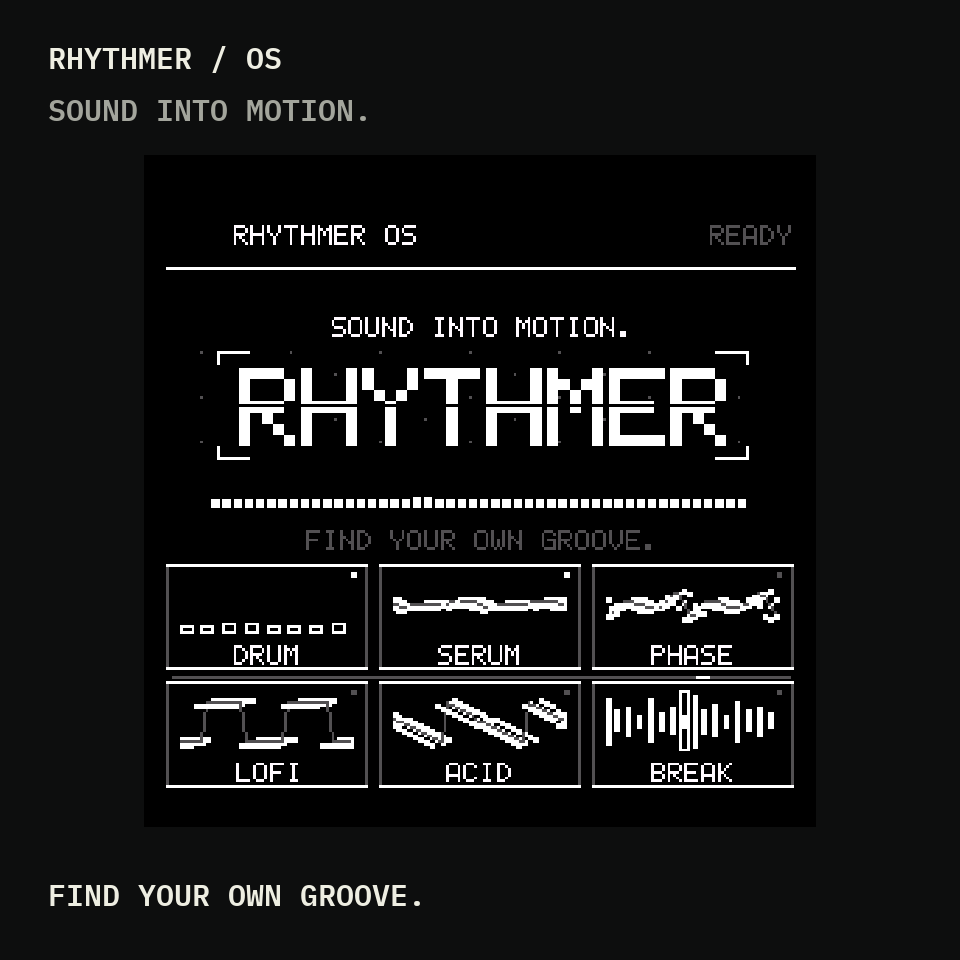
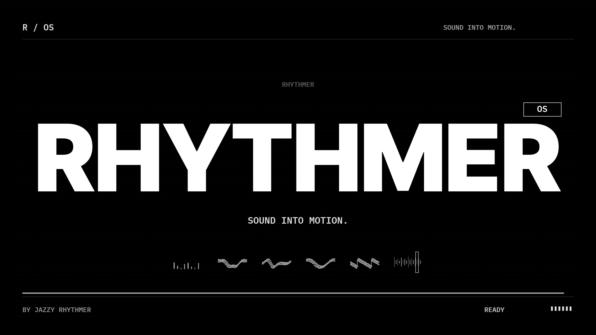
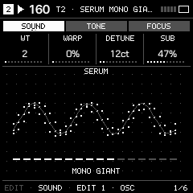
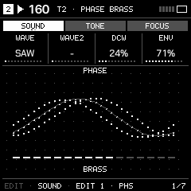
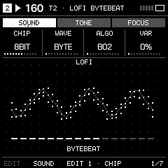
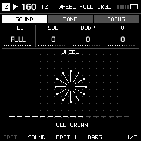
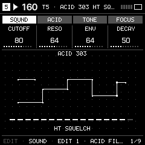
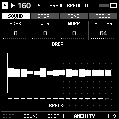

# Rhythmer

**Six assignable tracks for the M-VAVE FM-1.** Synthesized drums, nine musical synth models, 303-style acid generation and playable breakbeats, with one sequencer and a browser editor.

Free, open-source firmware by [Jazzy Rhythmer](https://www.youtube.com/@jazzyrhythmer). Optional support: [Ko-fi](https://ko-fi.com/jazzyrhythmer).

**Built on [JIANT](https://github.com/juanjiant-bit/JIANT).** Rhythmer keeps its sequencing, project management and system foundation, with a new monochrome interface and additional machines. The Acid engine/generator comes from X0X; Break manipulation comes from Amenity. Original authors and licenses remain credited.

## Watch Rhythmer

[Watch the 36-second opening with sound](https://jazzyrhythmer.github.io/Rhythmer/#opening) · [Download the Amen mix MP4](https://github.com/JazzyRhythmer/Rhythmer/releases/download/v0.1.0-beta.2/Rhythmer-OS-Opening-36s-1080p-Amen.mp4). Original opening sound plus an Amen Break section; sample credits below. The film shows host-rendered firmware UI, not physical-device footage.

**Installation status:** New Rhythmer installations are temporarily paused while a real-device audio-load report is investigated. Beta.2 remains a draft; V15 recovery and browser exploration remain available.

## Start here

[Play in your browser](https://jazzyrhythmer.github.io/Rhythmer/#play) · [Guide](https://jazzyrhythmer.github.io/Rhythmer/#guide) · [Editor](https://jazzyrhythmer.github.io/Rhythmer/editor/) · [Install](https://jazzyrhythmer.github.io/Rhythmer/installer/) · [Releases](https://github.com/JazzyRhythmer/Rhythmer/releases)

**Use official V15 when moving from another custom firmware to Rhythmer, or from Rhythmer to another custom firmware.** Direct foreign-custom transitions are unsupported. For a first install, official V15 is the recommended starting point. Back up the music you want to keep before changing firmware. The installer requires a final V15 recommendation acknowledgement, backup/risk acknowledgements and a separate audio-rights acknowledgement. Use Chrome or Edge and keep USB/power connected until verification finishes. A matching Rhythmer can be updated directly after backup.

## Acid generation and Break performance

| Acid / NEW + MUTATE | Break / chops + repeats |
| --- | --- |
|  |  |
| ACID track → EDIT → ACID tab → 303 GEN 1 / 2. OCT+ generates a new line; OCT− mutates it. SCL supplies the root and scale. [Acid guide](docs/ACID.md) | BREAK track → EDIT → BREAK tab. Play slices and repeat/up/down commands; SEQ edits the actual events. Hold SEQ for STRAIGHT / MUTATE / RANDOM. [Break guide](docs/BREAK.md) |

## The machines in motion

Host-rendered firmware UI driven by note, envelope and preset input; silent previews, not physical-device footage. FM6 cycles patches to show its operator networks. [Try the actual firmware with sound](https://jazzyrhythmer.github.io/Rhythmer/#play).

| | | |
| --- | --- | --- |
| **DRUM**  Synthesized percussion | **SERUM**  Wavetable morphing | **PHASE**  Phase distortion |
| **LOFI**  Digital textures | **ANALOG**  Classic waveforms | **FM6**  Six-operator patch networks |
| **WHEEL**  Harmonic organ layers | **FM+STAT**  Compact FM | **SWAV-SAW**  Layered saws |
| **SID-6581**  Chip-style synthesis | **ACID**  303-style bass | **BREAK**  Sequenced chops |

## Machines and sequencing

- Six assignable tracks; fresh projects start DRUM / SERUM / PHASE / LOFI / ACID / BREAK.
- Synths: Serum, Phase, LoFi, Analog, FM6, Wheel, FM+STAT, SWAV-SAW and SID-6581. All 41 selected Garden model presets remain; MONO2K-derived models add 17 starting sounds.
- Drums include five additional kits using 21 Hortator-derived MD synthesis models. Their model-specific voice limits are separate from the normal synth voice pool.
- Multiple Acid tracks; one Break machine per project, assignable anywhere. Machine-specific EDIT/SEQ pages follow the selected machine.
- Acid NEW/MUTATE always follows the root/scale in SCL; untouched scale defaults to minor.
- Break: 16 chops, 16 performance/repeat commands, source A/B and return commands in the real sequence. Hold SEQ for STRAIGHT / MUTATE / RANDOM, tail fills, beat shuffle, reverse order, shifts and A/B sequencing. Saved periodic mutation supports ORBIT/DRIFT.
- Break follows the normal track filter, ADSR and both LFOs. Fresh Break tracks start on A / Amen with a straight 32-step two-bar pattern; existing saved edits remain intact.
- Four projects, A–D sections, two LFOs per track, modulation slots, shared distortion/phaser/delay/reverb and performance effects. Four-/six-track modes preserve inactive tracks.
- Web editor for actual sounds/patterns, musical archive import/export and user-replaceable two-bar A/B loops. Conversion to 16 kHz mono packed PCM12 happens in the browser. Musical archives do not contain audio: retain your original samples separately.

## Release and compatibility

The public beta candidate uses `FM-1_748001`; the legacy local development build used shared identity `FM-1_900`. The package includes its update loader and both fixed A/B sample banks. Installing replaces factory audio in those banks; the loader protects project/settings sectors outside its explicit ranges. A/B write and CRC checks do not make foreign firmware projects compatible.

Beta.2 fixes SEQ piano-roll visibility: the displayed octave follows the current notes after track/bar changes and note edits. Seven host viewport checks and eleven actual-firmware emulator scenarios passed. The exact beta.2 binary has not been physically tested. The owner confirmed playback, installation from official V15 and return to official V15 on the earlier beta.1 package (`3d4e8655…`). This is a limited, owner-reported hardware test; read `HARDWARE-TEST-STATUS.json`. Direct foreign-custom transitions are unsupported: use V15 in between. A separate unit became non-responsive after the owner powered it off during an update; recovery is unconfirmed. Cold power-loss recovery is not established. The original release validation record describes the automated checks at package preparation. CPU measurements from an emulator are not real-device CPU measurements. Support for UC25HQ80 is implemented but has not been tested on that physical flash part.

The normal synthesis ceiling is twelve shared voices, with a measured-load relief ceiling of ten and the existing overload protections. Monophonic machines and MD models have their own constraints. No guarantee of unlimited polyphony is made.

## Samples, credits and license

Source is GPL-3.0-only; original component licenses and notices remain. The active firmware is in `jiant/`. See `docs/THIRD_PARTY.md`, `jiant/LICENSING.md` and the component license directories.

Amen: The Winstons, *Amen, Brother*, Gregory C. Coleman on drums; source via Amenity. Think: Lyn Collins, *Think (About It)*; a two-bar drum edit from owner-supplied files. Each prepared loop is two bars at 160 BPM, mono 16 kHz / PCM12. **These recordings are separate from the code license.** The owner directs their inclusion with credits; recording/composition redistribution permission has not been documented. Credits, installation acknowledgements, free access and this repository do not grant a blanket sample license. Replace either loop through the web editor or obtain permission appropriate to your use. See `audio-rights.json` and `THIRD-PARTY-AUDIO.txt`.

Built from community work including Felucca, JIANT, X0X, Amenity, Garden-FM, MONO2K and Hortator. Neither those authors nor M-VAVE or Elektron are claimed to endorse Rhythmer. Machinedrum and other referenced product names belong to their owners.

Independent community firmware, supplied without warranty to the extent permitted by law. Firmware changes can affect data or device operation. Mandatory legal rights and non-excludable liability remain unaffected. Read `LEGAL-NOTICE.txt`.
