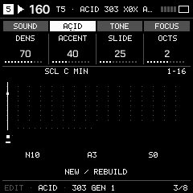

# Acid generation

The Acid machine is a native Hortator monophonic synth. X0X audio DSP is removed; only its TB-3PO MIDI generation and mutation remain. These operations create ordinary SEQ notes, accents and slides, and do not run continuously in the audio renderer.

## First line

1. Choose ACID on any active track. Confirming six-track mode assigns it to an empty T5; it is not restricted to T5.
2. Open SCL and choose ROOT and SCALE. The default is CHR. Acid GEN 2 displays/edits exactly these same values; there is no separate minor fallback.
3. Press EDIT repeatedly to ACID → 303 GEN 1. Set DENS, ACCENT, SLIDE and OCTS.
4. OCT+ creates NEW; OCT− applies MUTATE. Press PLAY and edit the actual MIDI in SEQ.
5. GEN 2 has the shared ROOT/SCALE, OCTAVE and MUT BARS. Keep MUT BARS OFF for a stable pattern; enable it deliberately for periodic mutation. Changing SCL alone does not rewrite existing notes.
6. Save a section/project and export a musical backup in the editor.

## Sound

All four Hortator sounds are available: HT SQUELCH, HT DEEPBASS, HT SCREAMER and HT SQUAREAC. SOUND exposes cutoff, resonance, envelope amount, decay, accent, SAW/SQR wave, slide and drive. MIDI generation and sound selection are separate. Old Rhythmer X0X Acid tracks safely migrate to native Hortator while retaining their notes and articulation; foreign standalone X0X project formats are not imported.

## HOME GEN

TARGET MIDI on the assigned Acid track makes a genre-driven mono bassline while keeping its sound, tempo, scale, automation and other tracks. ALL LOOP/PARTS/SONG preserves pre-existing Acid/Break parts; its existing, explicitly named SR_ACID sound recipe selects native Acid for that mono bass role only. Acid is excluded from ordinary bass, melody and chord sound pools. Break stays excluded from automatic instrument assignment.

Preview images are host-rendered actual firmware UI, not physical-device footage. Original upstream licenses and credits remain.
