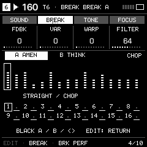

# Break sequencing and performance

Assign BREAK to any number of active tracks. Only sample banks A/B are shared; playback, selected source, sequencing, modulation and feedback are independent for each track. Fresh projects select A / Amen with an empty two-bar sequence; B is the corrected Think drum edit.

Press EDIT repeatedly, or use SELECT, to reach the BREAK tab. BRK PERF offers Amenity-derived sound and performance controls; BRK SEQ exposes the playback source and sequence options. The display follows the active chop and repeat position. A/B source changes, chop triggers, repeats and up/down commands can share the real SEQ pattern and be saved with the other tracks.

Hold SEQ on the Break track for STRAIGHT, MUTATE and RANDOM, tail fills, beat shuffle, reverse order, shifts and A/B sequencing. STRAIGHT writes ordered playback; MUTATE varies the existing cuts; RANDOM creates a new chop sequence. ORBIT and DRIFT support periodic changes; FREEZE pauses automatic edits.

SEQ manages the actual playback. EDIT shapes the sound. The ordinary track filter, ADSR and both LFOs also affect Break. HOME retains normal navigation; the dedicated RETURN action resets the live manipulator controls without rewriting your sequence. To rewrite ordered playback, hold SEQ and press F3 / STRAIGHT.

Replace either two-bar sample in the web editor's SAMPLES page. Sample recording rights remain separate from the software license; see THIRD-PARTY-AUDIO.txt. This silent preview is rendered from the firmware UI on a host, not recorded from hardware.

## First two-bar loop

1. Select the Break track with ALGORITHM (T6 in a fresh project).
2. Hold SEQ and press F3 / STRAIGHT, then release SEQ. This writes 32 steps: sixteen ordered chops with ties.
3. Press PLAY. Open ordinary SEQ to edit the actual chop events. An empty sequence is intentionally silent.
4. Use EDIT → BREAK to select A / Amen or B / Think and perform repeats. HOME still navigates normally.
5. Arm REC to record performance commands into the real sequence. Save the section and export a musical backup in the editor.

Held-SEQ automation keys include G3 MUTATE, A3 RANDOM, B3 FILL, C4 SHUFFLE, D4 reverse **order**, E4/F4 shifts, G4 A/B sequencing, C5 clear and D5 revert. The held-SEQ keyboard differs from the live performance keyboard. Reverse order does not reverse sample audio.

## Generate chops in the current genre

Hold HOME and turn SELECT to GEN. Choose a genre with knob 1 and the required T1–T6 with knob 4, then press OCT+. If that track uses Break, GEN shows Tn BREAK and its dedicated controls, and writes genre-aware chop MIDI only. It retains tempo, sounds, effects and other tracks. Hip-hop profiles leave gaps; DRUNKEN HH adds deliberate push/pull; jungle uses stronger activity and bounded answer rolls. GLO + G4 undoes the operation.

## Your own two-bar samples

Open [SAMPLES in the web editor](https://jazzyrhythmer.github.io/Rhythmer/editor/?target=browser#samples). Keep the original, choose A or B, enter the **original file's source BPM**, and align an eight-beat / two-bar region to its first downbeat. Review conversion, listen, and confirm the destination before transfer. Conversion produces a 160 BPM, 16 kHz mono PCM12 bank within the device's slot budget.

This converter changes playback rate; use your DAW to export at 160 BPM first if pitch preservation matters. The slots are shared across projects. Musical archives do not contain sample audio: keep original files or converted .slot banks. A firmware installation restores the package's factory loops.

[Detailed manual: Break start, SEQ, performance, automation and sample upload](https://jazzyrhythmer.github.io/Rhythmer/#guide).
